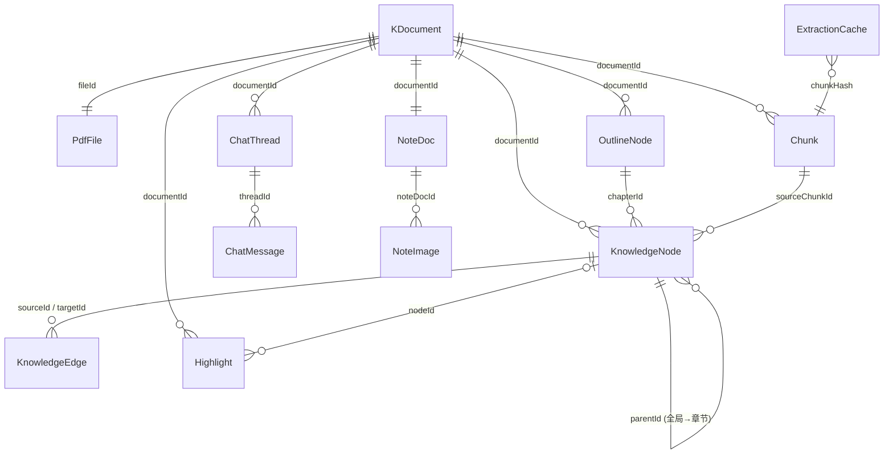

# 第一轮设计交付（与 Step 0 同级，先于任何业务组件）

> 任务书依据：§5.2（数据模型）、§7「第一轮」、§8（工程纪律）。
> 本文件不包含业务实现；除 `web/src/domain/**`、`web/src/db/database.ts` 这两个「数据模型交付物」外，本轮没有写任何业务代码。

## 0. 结论先行

| 交付项 | 状态 | 落地位置 |
| --- | --- | --- |
| ① 完整目录结构规划 | 完成 | 本文件 §1 |
| ② 全部实体 TS 类型 + Dexie table schema + zod schema | 完成 | `web/src/domain/{enums,types,schemas}.ts`、`web/src/db/database.ts` |
| ③ 开放问题与默认选择 | 完成 | 本文件 §2（含笔记形态 / Markdown 图片策略 / 关系词表） |
| Step 0 脚手架与空跑 | 完成 | 本文件 §4 有真实命令输出 |

三个必须由你拍板的默认值，我先给出了结论（理由见 §2）：

- **笔记面板形态**：右侧 Dock 的第二个 Tab（与 AI 聊天同栏切换），不是抽屉。
- **Markdown 图片策略**：默认 inline base64 单文件；超过阈值自动降级为 `akn-assets/<id>.png` 占位链接。
- **关系标签**：6 个受控关系 + `custom` 逃生口，`custom` 必须自带 ≤12 字标签，受控关系禁止自带标签。

---

## 1. 交付①：完整目录结构规划

图例：`[S0]` 本轮已落地 / `[S1]…[S5]` 对应任务书步骤落地 / `[P1]` 仅占位。

```
ai-knowledge-navigator/
├── package.json                     [S0] 根脚本：dev / build / typecheck / test
├── pnpm-workspace.yaml              [S0] workspace + allowBuilds（pnpm 11+ 用 allowBuilds）
├── pnpm-lock.yaml                   [S0]
├── tsconfig.base.json               [S0] 只放严格性开关，module 由各包自定
├── .gitignore                       [S0] .env.local / dist / node_modules
├── .env.example                     [S0] 变量清单（不含真实密钥）
├── README.md                        [S0]
│
├── docs/
│   ├── ROUND1-DESIGN.md             [S0] ← 本文件
│   ├── STEP1-LAYOUT.md              [S1] Step 1 验收记录（16 项 CDP 断言）
│   └── PROMPTS.md                   [S3] prompt 版本与输出契约对照表
│
├── scripts/
│   └── ui-check.mjs                 [S1] 无头 Chrome + CDP 交互验收（零第三方依赖）
│
├── web/
│   ├── index.html                   [S0]
│   ├── package.json                 [S0]
│   ├── tsconfig.json                [S0] bundler 解析 + vite/client 类型
│   ├── vite.config.ts               [S0] 5173 + /api 代理 → 8787
│   ├── vitest.config.ts             [S0] node 环境（纯逻辑测试不需要 DOM）
│   └── src/
│       ├── main.tsx                 [S0] createRoot
│       ├── App.tsx                  [S1] 组合根：只渲染 AppLayout（Step 0 占位页已替换）
│       ├── index.css                [S0] Tailwind 入口 + 设计令牌
│       ├── vite-env.d.ts            [S0]
│       │
│       ├── domain/                  ← 交付②（本轮落地，Step 3 继续增补纯函数）
│       │   ├── enums.ts             [S0] 枚举 + 受控词表 + 语义说明
│       │   ├── types.ts             [S0] 全部实体接口
│       │   ├── schemas.ts           [S0] 全部 zod schema + parseStrict
│       │   ├── schemas.test.ts      [S0] 契约测试（类型互证 + 坏数据拦截）
│       │   ├── index.ts             [S0] 统一出口
│       │   ├── nodeStyle.ts         [S3] 颜色状态机纯函数
│       │   ├── merging.ts           [S3] 实体合并（titleNorm + merges）
│       │   ├── anchor.ts            [S3] quote → 页内定位三级降级
│       │   └── markdown.ts          [S5] TipTap JSON → Markdown 序列化
│       │
│       ├── db/
│       │   ├── database.ts          [S0] Dexie 表结构 / 版本 / 懒单例
│       │   └── repositories/        [S2/S3] documents, outline, highlights, nodes, edges, cache
│       │
│       ├── stores/                  [S1] Zustand 五个 store（已落地，见下）
│       │   ├── uiStore.ts           [S1] rightTab / panelWidths / exportPrefs（persist + 脏数据归一）
│       │   ├── documentStore.ts     [S1] 当前文档 / outline / 三态
│       │   ├── graphStore.ts        [S1] 节点边字典 / 选中 / toggleMastery / 抽取进度
│       │   ├── chatStore.ts         [S1] 线程 / 消息 / context chips / 流式标记
│       │   ├── notesStore.ts        [S1] NoteDoc / 图片 / 脏标记 / 保存三态
│       │   └── index.ts             [S1] 统一出口
│       ├── app/                     [S1] 布局层（已落地）
│       │   ├── AppLayout.tsx        [S1] 三栏 grid + 拖拽 + ResizeObserver 重钳制
│       │   ├── TopBar.tsx           [S1] 标识 / Step 徽标 / 开发态栏宽 / 重置 / 后端探针
│       │   ├── useServerHealth.ts   [S1] /api/health 探针（zod 校验响应）
│       │   ├── layout/
│       │   │   ├── layoutMath.ts    [S1] 宽度钳制纯函数 + 脏数据归一（15 个单测）
│       │   │   ├── layoutMath.test.ts
│       │   │   ├── usePanelResize.ts[S1] 拖拽/键盘接线（window pointer 事件）
│       │   │   └── Splitter.tsx     [S1] role=separator + 键盘微调
│       │   └── panels/
│       │       ├── LeftSidebar.tsx  [S1] 目录空态（Step 2 灌 outline）
│       │       ├── PdfPane.tsx      [S1] PDF 占位 + 页码指示
│       │       └── RightDock.tsx    [S1] Tab：AI 伴读 / 笔记
│       ├── pdf/                     [S2] PdfPane, OutlineTree, highlighter 封装
│       ├── graph/                   [S3] KnowledgeGraph, NodeCard, RelationEdge, subgraph
│       ├── llm/                     [S3] client.ts（唯一出口）+ prompts/ + pipeline/
│       ├── chat/                    [S4] ChatPanel, ContextChips, CitationCard
│       ├── notes/                   [S5] NoteEditor(TipTap), 自定义节点
│       ├── export/                  [S5] markdownExport.ts（+ [P1] pdf）
│       ├── sync/                    [P1] provider 接口空实现 + 配置表单占位
│       └── lib/                     [S0…] id、时间、断言等纯工具
│
└── server/
    ├── package.json                 [S0]
    ├── tsconfig.json                [S0] NodeNext（产物可直接 node 运行）
    ├── .env.local                   [S0] 用户自建，git-ignored
    └── src/
        ├── index.ts                 [S0] Hono 实例 + /api/health；[S3] 挂 LLM 路由
        ├── env.ts                   [S0] 只读 .env.local / .env
        ├── llm/                     [S3] client(重试/超时) / routes / sse / errors(状态码归一)
        └── middleware/              [S3] bodyLimit(413) / errorHandler
```

分层纪律（贯穿全项目）：

1. **domain 不依赖任何框架**：不 import React / Dexie / pdfjs / DOM，可被 Vitest 直接跑。
2. **db 只依赖 domain**：仓储层负责 zod 复核（从 IndexedDB 读出来的数据同样视为不可信）。
3. **llm 是唯一出网层**：业务组件永远只调 `llmClient`，不出现任何 LLM 域名。
4. **stores 只依赖 domain/db/llm**：组件通过 store 拿数据，禁止组件直接开 IndexedDB 事务。

---

## 2. 交付③：开放问题与默认选择

> 每条给：**默认选择 / 理由 / 影响面**。你只需要对不认同的条目打回，其余视为确认。

### Q1 笔记面板形态 → **右侧 Dock 的 Tab（与 AI 聊天切换）**

- 理由：任务书 §3 模块四第 1 条已写死「右侧固定聊天侧边栏，与笔记面板用 Tab 切换」；§7 Step 1 也写死三栏 + 右栏 Tab。选抽屉会同时违背两处。
- 影响面：Step 1 的 `RightDock` 负责 Tab 状态；笔记面板宽度继承右栏拖拽宽度（同一列，不额外挤压 PDF 区）。
- 附带默认：Tab 记忆在 `uiStore.rightTab`，刷新后保持。

### Q2 Markdown 图片策略 → **默认 inline base64，超阈值降级为占位链接**

- 默认：`` 实际写 ``，导出为**单文件**。
- 阈值：单图 > 1.5 MB 或全篇图片合计 > 8 MB → 该图自动降级为 ``，并在导出结果顶部插入一条 `> 提示：N 张图片已降级为占位链接…`。
- 理由：①「一键导出**纯净** Markdown（`.md`）」= 单文件最干净；② Obsidian / Typora 都能直接渲染 data URI；③ 图谱截图是 PNG、宽度 ~1200px，常见 100–400 KB，1.5 MB 阈值足以覆盖绝大多数场景而不会把 `.md` 撑成几十 MB。
- 可配置：`uiStore.exportPrefs.markdownImageMode = 'inline-base64' | 'placeholder'`（默认 `inline-base64`），用户可强制占位。
- 降级表（Step 5 严格按此序列化）：

| TipTap 节点 | Markdown 降级 |
| --- | --- |
| `heading` / `paragraph` / `bulletList` / `orderedList` / `blockquote` / `codeBlock` | 标准 Markdown |
| `nodeCard`（图谱节点卡片） | 引用块：`> **【节点】标题**`<br>`> 重要度 ★★★★☆ · 状态：未掌握 · 上下游：依赖 A、触发 B` |
| `graphImage`（React Flow 截图） | ``，超阈值 → `` |
| `highlightQuote`（PDF 高亮摘录） | `> 原文 quote`<br>`> — p.<页码>` |
| `chatExchange`（AI 回答卡片） | `> **[AI]** 正文…`<br>`> 出处：p.12「quote」` 或 `> 出处：无直接出处` |
| `citationList` | 有序列表，逐条 `页码 + quote`；`verified=false` 一律渲染「无直接出处」 |

### Q3 关系标签受控词表 → **6 受控 + custom**

| 值 | 显示 | 语义（同时进 prompt） | 边色 |
| --- | --- | --- | --- |
| `depends_on` | 依赖 | source 要成立/工作，必须先理解 target | `#f59e0b` |
| `triggers` | 触发 | source 发生导致 target 发生/被激活 | `#ef4444` |
| `belongs_to` | 属于 | source 是 target 的下级构成/分类 | `#64748b` |
| `extends` | 扩展 | source 在 target 基础上增强 | `#22c55e` |
| `implements` | 实现 | source 是 target（标准/算法/协议）的实现 | `#3b82f6` |
| `contrasts_with` | 对比 | 并列的对照/替代方案 | `#a855f7` |
| `custom` | 自定义 | 以上都不贴切，必须给出 `relationLabel`（≤12 字） | `#94a3b8` |

- 规则（schema + prompt 双向约束，已用 zod 钉死）：`custom` 必须带 `relationLabel`；受控关系**禁止**自带 label，防止「依赖/依赖于/强依赖」这类漂移。
- 不设 `part_of`：与 `belongs_to` 重叠，词表越短越稳。

### Q4 重要度定标 → **1–5 整数 + 固定颜色 ramp + 固定尺寸 ramp**

`nodeStyle(importance, mastery)` 是**唯一**着色入口（Step 3 实现，签名固定为两个参数；高亮/弱化用组件上的 opacity 覆盖，不进这个函数）。

| 重要度 | 直径(px) | 未掌握 fill | 已掌握 fill | 文字 |
| --- | --- | --- | --- | --- |
| 5 | 96 | `#7f1d1d` | `#14532d` | `#f8fafc` |
| 4 | 82 | `#991b1b` | `#166534` | `#f8fafc` |
| 3 | 70 | `#b91c1c` | `#15803d` | `#f8fafc` |
| 2 | 58 | `#ef4444` | `#22c55e` | `#111827` |
| 1 | 48 | `#fca5a5` | `#86efac` | `#111827` |

- 契约：`nodeStyle(importance, mastery) => { fill, stroke, textColor, diameter, fontSize, ring }`；**同 important 在两态下直径完全一致**（切掌握不跳尺寸，只换色系）。
- 无重要度预测值的节点/章节 → 中性灰 `#475569`，不进入红/绿 ramp（对应「不得伪造重要度」）。

### Q5 实体合并规则 → **只做两条确定性规则，不做模糊自动合并**

1. `titleNorm`：NFKC → 去 LaTeX/Markdown 记号（`$\{}`*_#`）→ 小写 → 括号内容移入 `aliases` → 删除所有 Unicode 空白与标点。**不做**编辑距离、不做同义词词典。
2. 合并仅在 reduce 阶段发生，且只认两种证据：`titleNorm` 完全相等，或 LLM `merges[]` 显式声明（`canonical` + `aliases`）。
3. 冲突（同一 alias 指向两个 canonical）→ 保留 `merges` 中第一条，其余**保留为独立节点**并在控制台/`merges` 记录里标记 `conflict`，绝不静默丢弃。

- 理由：误合（把「Attention」和「Self-Attention」合掉）比不合更难发现、更难修；宁可多节点，交给用户手动连边。

### Q6 锚点定位 → **quote 三级降级，失败就承认失败**

块内定位顺序：① 原文精确匹配；② 空白折叠（`\s+` → 单空格）后再匹配；③ 大小写不敏感匹配。三级都失败 → `anchor = null`（UI 显示「无原文锚点」），**不允许**用「最相近的一句」冒充。页内 `rects` 在 Step 2 由 pdf.js 文本层计算，算不出就留空数组（只能跳页、不能框选）。

### Q7 缓存 key 与 prompt 版本

`key = ${documentId}:${stage}:${chunkHash ?? 'global'}:${promptVersion}`

- `chunkHash` = SHA-256(块文本 + pageStart + 章节标题) 取前 16 位十六进制（Web Crypto）。
- `promptVersion` 形如 `chunk-extract@1`；**改 prompt 必须 +1**，旧缓存自然失效，不做迁移。
- 章节子图谱：直接按 `chunk_extract` 的 key 复用块缓存，命中即 0 次网络调用。
- zod 失败：先追加一次 `json_repair` 调用（独立缓存条目），仍失败 → `status='failed'` + `error` 入库，UI 允许「单块重试」，全局图**不渲染半成品**。

### Q8 引注语义（禁止编造页码）

- `Citation.verified` 必须由**前端二次校验**得出：把 LLM 给的 `page + quote` 拿去 pdf.js 文本层查，命中才 `verified=true`。
- 查不到 → `verified=false`、`page=null`，UI 固定文案「无直接出处」，原 quote 以「模型声称」样式展示（灰色 + 不可点击）。
- zod 已强制：`verified=true` 必须有页码且 quote 非空；`role=assistant && status=done` 必须至少一条引注（可以是 `verified=false` 的那条）。

### Q9 端口 / 代理 / 密钥

- 前端 5173（`strictPort`），服务端 8787；`/api` 由 Vite 代理到 `127.0.0.1:8787`（dev 与 preview 都配）。前端因此永远同源，不需要 CORS，也不存在「前端直连 LLM 域名」。
- 密钥只从 `server/.env.local` 读；`.env.example` 只列变量名；zod 不接收任何 `VITE_` 前缀的密钥。

### Q10 PDF 依赖版本锁定

- `react-pdf-highlighter` 当前 npm `latest` 是 `8.0.0-rc.0`，其内部硬依赖 `pdfjs-dist@4.4.168`。本项目把 `pdfjs-dist` **精确锁定 4.4.168**，避免双份 pdf.js / worker 版本不一致。
- 已核对 `dist/types.d.ts`（不是猜的）：`IHighlight = { id, content: Content, comment: Comment, position: ScaledPosition }`；`ScaledPosition = { boundingRect: Scaled, rects: Scaled[], pageNumber, usePdfCoordinates? }`；`Scaled = { x1,y1,x2,y2,width,height,pageNumber? }`。本项目的 `Highlight` 就是 `IHighlight` + `documentId/nodeId/createdAt/updatedAt`。
- 风险与备选：若 Step 2 发现 rc 版组件 API 与任务书要求冲突，按工程纪律 §8.5 停下报备，备选顺序为 ① 降到 7.0.0 ② 用 pdf.js 文本层自写高亮层（保留同一份 `Highlight` 持久化结构）。

### Q11 存储与命名约定

- 主键：`crypto.randomUUID()` 字符串（不用自增，便于导入/合并）。
- 时间戳：epoch 毫秒（number），Dexie 可直接排序。
- `enabled: 0 | 1`（Dexie 不能索引 boolean）。
- 业务实体 `Document` 在代码里一律叫 `KDocument`：本应用到处操作 DOM/PDF 容器，与全局 `Document` 同名是长期隐患。
- 嵌套结构（`Highlight.position.pageNumber`）不建索引，索引只落在顶层字段。

### Q12 UI 语言与视觉基调

- 界面文案中文；暗色底（`index.css` 里 `--color-akn-*` 令牌），红/绿状态机在暗底上对比度更高。
- 三栏默认宽度：左 260 / 中 自适应 / 右 380（最小宽度：左 200 / 中 360 / 右 320）。

### Q13 状态与三态约定

- Zustand 五个 store：`uiStore`（栏宽、Tab、偏好）、`documentStore`（当前文档、目录、处理状态机）、`graphStore`（节点/边/选中/掌握切换/抽取进度）、`chatStore`（线程、消息、流式、context chips）、`notesStore`（NoteDoc、图片、脏标记）。
- 所有异步一律 `status: 'idle' | 'loading' | 'ready' | 'error'` + `error: string | null`；**没有**「静默空白」分支。

---

## 3. 交付②：数据模型

### 3.1 实体与表

| 实体 | Dexie 表 | 主键 | 索引 | 关键说明 |
| --- | --- | --- | --- | --- |
| `KDocument` | `documents` | `id` | name, status, createdAt | 只存句柄 `fileId`，不存 PDF 本体 |
| `PdfFile` | `pdfFiles` | `id` | documentId | `data: ArrayBuffer`，Blob 由仓储层包装 |
| `OutlineNode` | `outlineNodes` | `id` | documentId, parentId, page, `[documentId+order]` | `predictedImportance` + `importanceSource` 保证不伪造 |
| `KnowledgeNode` | `knowledgeNodes` | `id` | documentId, parentId, chapterId, scope, importance, mastery, sourceChunkId, `[documentId+scope]`, `[documentId+chapterId]` | 全局/章节同一张表，`parentId` 分层 |
| `KnowledgeEdge` | `knowledgeEdges` | `id` | documentId, sourceId, targetId, relationType, `[documentId+sourceId]` | 有向；受控标签由 schema 校验 |
| `Highlight` | `highlights` | `id` | documentId, nodeId | 结构对齐 react-pdf-highlighter |
| `Note` | `notes` | `id` | documentId, highlightId, nodeId, createdAt | 独立备注（可挂高亮/节点） |
| `Chunk` | `chunks` | `id`(=chunkHash) | documentId, order, `[documentId+order]` | map 阶段切块 |
| `ExtractionCache` | `extractionCaches` | `key` | documentId, stage, status, promptVersion, updatedAt | `payload` 只存 zod 通过的数据 |
| `ChatThread` / `ChatMessage` | `chatThreads` / `chatMessages` | `id` | documentId / threadId, role, createdAt, `[threadId+createdAt]` | 消息带 `citations[]` 与 `context[]` 快照 |
| `NoteDoc` / `NoteImage` | `noteDocs` / `noteImages` | `id` | documentId, updatedAt / noteDocId, documentId | TipTap JSON 是唯一真源 |
| 同步配置 | `syncConfigs` | `id` | target, enabled | P1 占位，`enabled: 0|1` |

### 3.2 关系图



### 3.3 关键设计决策

| # | 决策 | 理由 |
| --- | --- | --- |
| D1 | 全局图与章节图**同表**，用 `parentId + chapterId + scope` 表达层级 | 任务书明确「同一套实体 + 层级关系」；避免两套数据互相漂移 |
| D2 | `OutlineNode` 显式区分 `predictedImportance` 与 `importanceSource` | 「无预测值给中性占位色、不得伪造重要度」需要结构化字段，不能靠 UI 猜 |
| D3 | `ExtractionCache.payload` 只存 zod 通过的 `ExtractionPayload` | 「未经 zod 校验的数据不得进入 IndexedDB」——把纪律做进类型 |
| D4 | 缓存 key 含 `promptVersion`，改 prompt 即失效 | 避免「同名 key 换语义」导致的静默错配 |
| D5 | `Citation.verified` 是显式布尔，且有跨字段 zod 约束 | 「禁止编造页码」必须可被 schema 拒绝 |
| D6 | 高亮持久化结构与库的 `ScaledPosition` 同构（`x1/y1/x2/y2`）；`LTWHP`（`left/top`）只用于视口渲染 | 读库 d.ts 确认：`IHighlight.position` 是 `ScaledPosition`，`ViewportHighlight.position` 才是 `LTWHP`。已用编译期断言钉死（见 §4.3） |
| D7 | `figure.kind = 'caption_only' | 'vision'` | v1 只做 Caption 启发式，P1 视觉识别只换 kind，不改表 |
| D8 | `NoteDoc` 只存 TipTap JSON，Markdown 实时序列化 | 单一真源；降级表示由 `markdown.ts` 一处决定 |
| D9 | 懒加载 Dexie 单例（`getDb()`） | 模块顶层不碰 IndexedDB，node 测试可直接 import domain/db |

### 3.4 代码位置

- 枚举与受控词表：`web/src/domain/enums.ts`
- 实体接口：`web/src/domain/types.ts`
- zod schema + `parseStrict`：`web/src/domain/schemas.ts`
- Dexie 表结构 / 版本：`web/src/db/database.ts`
- 契约自检：`web/src/domain/schemas.test.ts`

---

## 4. Step 0 验收记录（本节是实际执行结果，不是预期）

### 4.1 验收命令与结果

| # | 验收项 | 命令 | 实际结果 |
| --- | --- | --- | --- |
| 1 | 依赖安装可复现 | `pnpm install` | ✅ `Done in 53.5s using pnpm v12.8.1`；esbuild postinstall 已执行；无 `ERR_PNPM_IGNORED_BUILDS` |
| 2 | 类型零错误 | `pnpm -r typecheck` | ✅ `server typecheck: Done` / `web typecheck: Done` |
| 3 | 全量构建 | `pnpm -r build` | ✅ `vite v8.3.8` 产出 `dist/index.html` + `index.css 11.03 kB` + `index.js 222.66 kB`；`server/dist/index.js` |
| 4 | 单元测试 | `pnpm -r test` | ✅ `Test Files 1 passed / Tests 12 passed`（web），server `--passWithNoTests` |
| 5 | 前后端同起 | `pnpm dev` | ✅ 见 4.2 启动日志 |
| 6 | 服务端健康检查 | `curl -s 127.0.0.1:8787/api/health` | ✅ `HTTP 200` · `{"ok":true,"service":"akn-server","version":"0.1.0","llmConfigured":false}` |
| 7 | Vite 代理连通 | `curl -s 127.0.0.1:5173/api/health` | ✅ `HTTP 200`，返回同上（同源代理生效，前端不直连） |
| 8 | 未知路由归一化 | `curl -s 127.0.0.1:8787/api/nope` | ✅ `HTTP 404` · `{"ok":false,"error":{"code":"NOT_FOUND",...}}` |
| 9 | 编译产物可直跑 | `PORT=8790 node server/dist/index.js` | ✅ `HTTP 200`（NodeNext + `.js` 扩展名正确，产物非只能 tsx 跑） |
| 10 | 页面无致命错误 | 无头 Chrome `--dump-dom --enable-logging=stderr` | ✅ DOM 含「后端代理正常 · akn-server v0.1.0」；控制台仅 Vite 连接 INFO + React DevTools 提示，**无 CONSOLE ERROR** |

### 4.2 `pnpm dev` 启动日志（原样）

```
$ concurrently -k -n web,server -c cyan,magenta "pnpm --filter @akn/web dev" "pnpm --filter @akn/server dev"
[web] $ vite
[server] $ tsx watch src/index.ts
[web]
[web]   VITE v8.3.8  ready in 180 ms
[web]
[web]   ➜  Local:   http://localhost:5173/
[server] [akn-server] 已启动：http://127.0.0.1:8787
[server] [akn-server] 未检测到 DEEPSEEK_API_KEY（server/.env.local），/api/llm/* 将在 Step 3 拒绝调用
```

### 4.3 高亮结构与库对齐（编译期断言，`schemas.test.ts`）

`react-pdf-highlighter@8.0.0-rc.0` 的 `dist/types.d.ts` 实读结果：

```ts
Scaled      = { x1, y1, x2, y2, width, height, pageNumber? }
LTWHP       = { left, top, width, height, pageNumber? }
Position    = { boundingRect: LTWHP, rects: LTWHP[], pageNumber }          // 视口坐标
ScaledPosition = { boundingRect: Scaled, rects: Scaled[], pageNumber, usePdfCoordinates? } // 持久化坐标
IHighlight  = { id, content: Content, comment: Comment, position: ScaledPosition }
```

因此 `Highlight.position` 按 `ScaledPosition` 建模，并在测试里写了**双向可赋值断言**：

- `Highlight.position → ScaledPosition` ✅
- `{ id, content, comment, position } → IHighlight` ✅

> 这条断言在第一次写完后立刻抓到一个真实不兼容：我们用了 `readonly PdfRect[]`，而库要 `Scaled[]`（可变数组）。已改成可变数组并注释原因——这正是「以库的 schema 为准」该有的验证方式。

### 4.4 已安装版本（实测，非取 latest 假设）

| 包 | 版本 | 备注 |
| --- | --- | --- |
| react / react-dom | 18.3.1 | 任务书锁定 React 18（npm latest 已是 19） |
| typescript | 5.9.3 | 选 5.9 而非 7.0：strict 全量可用，生态无破坏性变更 |
| vite | 8.3.8 | Node 24 满足 `^20.19 || >=22.12` |
| @vitejs/plugin-react | 6.3.0 | |
| tailwindcss / @tailwindcss/vite | 4.3.5 | 走 `@theme`，无 `tailwind.config.js` |
| zod | 4.6.7 | 注意 v4 的 `z.record` 需要两个参数 |
| dexie | 4.4.7 | |
| zustand | 5.1.0 | |
| reactflow | 11.11.4 | 官方 React Flow 包（非 `@xyflow/react`） |
| @tiptap/react / starter-kit / pm | 3.34.0 | |
| pdfjs-dist | 4.4.168 | **精确锁定**，与 highlighter 内部依赖对齐 |
| react-pdf-highlighter | 8.0.0-rc.0 | npm `latest` 指向 rc，见风险 1 |
| hono / @hono/node-server | 4.13.19 / 2.1.9 | |
| dotenv / tsx | 18.0.10 / 4.23.15 | |
| vitest | 5.1.1 | node 环境，无需 jsdom |
| concurrently | 10.0.7 | |

### 4.5 截图

`docs/step0-screenshot.png`（1280×800，无头 Chrome 实际渲染）。我这边无法在模型侧看图，请直接打开确认视觉；结构与样式已通过 DOM/产物 CSS 双重核对（Tailwind 工具类已生成、`--color-akn-bg` 已进入生产 CSS）。

---

## 5. 风险登记（需要你知情，不影响本轮开工）

1. **react-pdf-highlighter 只有 rc**（`8.0.0-rc.0`）：API 可能与正式版有差异。缓解：锁定 `pdfjs-dist@4.4.168` 对齐；Step 2 若受限，按 §8.5 停下报备（备选见 Q10）。
2. **DeepSeek 引注可靠性**：模型倾向给出「看起来对」的页码。缓解：前端 pdf.js 文本层二次校验，失败即 `verified=false`。
3. **超大文档 reduce 成本**：单次 reduce 汇总全局节点可能超长。缓解：reduce 也分批（章节摘要 → 全局），必要时两级 reduce；本轮已在 `ExtractionCache.stage` 预留 `global_reduce`。
4. **pnpm 12 的构建审批**：`pnpm 11+` 用 `allowBuilds`（不是旧的 `onlyBuiltDependencies`），已写进 `pnpm-workspace.yaml`，否则 `pnpm install` 会以 `ERR_PNPM_IGNORED_BUILDS` 失败。
5. **Tailwind 4 + Vite 8 组合**：采用 `@tailwindcss/vite`（无 `tailwind.config.js`），已在 Step 0 构建验证；若后续需要自定义 token，用 `@theme`（已在 `index.css` 用上）。

---

## 6. 实施偏差记录（Step 2–5 落地后补记）

设计交付时的目录规划是「意图」，实现过程中有几处合理的落点调整。逐条登记，避免文档假装与代码完全一致：

| 规划位置 | 实际位置 | 原因 |
| --- | --- | --- |
| `app/layout/ResizablePanel.tsx` | `app/layout/Splitter.tsx` + `usePanelResize.ts` + `layoutMath.ts` | 拖拽拆成「纯几何 / 事件接线 / 视图」三层，几何部分才能脱离 DOM 单测（15 个用例） |
| `app/layout/RightDock.tsx` | `app/panels/RightDock.tsx`（与左侧栏、PDF、中栏容器同目录） | 四个面板同层更直观，`app/layout/` 只留布局基础设施 |
| `domain/merging.ts`、`domain/anchor.ts` | `llm/pipeline/merge.ts`、`llm/pipeline/anchor.ts` | 二者只服务于抽取流水线，放在 pipeline 内聚性更高；仍是纯函数并有单测 |
| `domain/markdown.ts` | `notes/markdown.ts` | 序列化只服务于笔记导出，与 TipTap 节点定义放同目录 |
| （未规划） | `app/panels/CenterPane.tsx` | PDF 与图谱需要在中栏切换；PDF 常驻挂载（卸载会重建 viewer 并丢滚动位置），图谱用覆盖层 |
| （未规划） | `fixtures/`、`scripts/step2–5-check.mjs` | 验收需要真实 PDF 与可复现的 CDP 脚本；这是「每步给真实输出」的必要基础设施 |

其余规划（stores 五个、db 仓储、llm 唯一出口、prompts 带版本、缓存 key、nodeStyle、两级图、TipTap 自定义节点、sync 占位）与实现一致。
